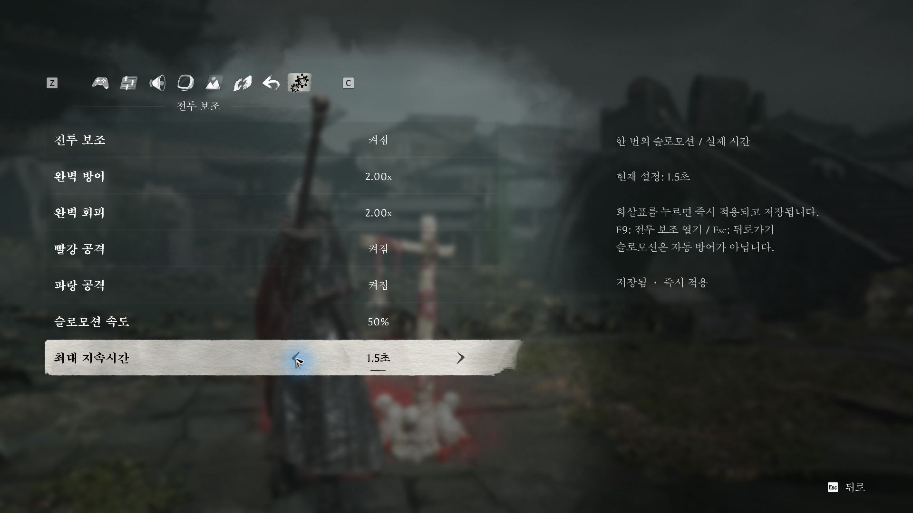

# Jidon PBZ — 자체 로더와 전투 보조

요약 → 설치·설정 → [검증과 재현](docs/TECHNICAL.md) 순서로 읽습니다. **0.2.0-preview**: 게임 기본 설정 메뉴에 전투 보조 탭을 추가합니다. 실제 적 공격에 대한 검증은 아직 완료되지 않았습니다.

## 요약

- 기존 Mods Menu 원본 DLL을 격리하고, 이 저장소의 C++ 소스로 빌드한 로더와 자체 JavaScript를 사용합니다. 원본 모드 DLL·스크립트·ZIP은 포함하지 않습니다.
- 완벽 방어·완벽 회피 판정 시간은 현재 설정상 2배입니다. 빨강·파랑 공격은 50% 속도, 한 번에 최대 실제 시간 1.5초로 느려지도록 구현했습니다. 자동 방어와 연타 패널티 제거는 포함하지 않습니다.
- **게임 기본 설정의 ‘전투 보조’ 탭**에서 배율과 슬로모션을 바꾸고 저장합니다. 플레이 중 F9로 바로 열 수 있으며, 게임의 설정 행·선택 표시·설명란·뒤로가기를 사용합니다.
- 자체 `dist/hid.dll`을 포함하므로 이 저장소만 받으면 설치할 수 있습니다. **파일명만 같고 기존 Mods Menu의 DLL과는 다른 파일**입니다. 소스에서 다시 빌드할 수 있으며 자체 제작이 무결점의 보증은 아닙니다.
- 설정은 Git으로 명시적으로 내보내고 가져옵니다. 개인 세이브·계정 정보는 올리지 않습니다. 이동·초기화 부적 99개 지급은 [별도 선택 도구](docs/ITEMS.md)이며 자동 실행하지 않습니다.

아래는 실제 게임의 설정 화면입니다. 맨 오른쪽 톱니바퀴의 **전투 보조** 탭에서 일곱 항목을 조절합니다.



## 다른 PC에 설치

Windows와 Python 3.11 이상이 필요합니다. Steam 빌드 **26367565**, 게임 버전 **302256-17280**의 정확한 실행 파일만 허용합니다. 업데이트 후 검사가 실패하면 적용을 멈춥니다.

1. [비공개 저장소](https://github.com/jidon333/PBZ-Mod-Sync)를 복제하거나 Code → Download ZIP으로 받습니다.
2. 게임을 종료하고 저장소 폴더에서 PowerShell을 엽니다.
3. 실제 게임 경로에 맞춰 미리보기 → 설치 → 파일 검증을 실행합니다.

```powershell
$game = 'D:\Program Files (x86)\Steam\steamapps\common\PBZ'
py -3.12 tools/mod_sync.py install --game $game
py -3.12 tools/mod_sync.py install --game $game --apply
py -3.12 tools/mod_sync.py verify --game $game
```

`--apply`만 파일을 변경합니다. 기존 파일은 `.local/backups`에 백업합니다. 이전 자체 배포본은 DLL·스크립트의 두 해시가 모두 일치할 때만 업그레이드합니다. 출처가 다른 `hid.dll`이나 기존 Mods Menu가 있으면 중단합니다. 설치·업그레이드는 이미 저장된 개인 설정을 보존합니다. Windows System32의 DLL은 건드리지 마세요.

Steam에서 평소처럼 실행하면 적용됩니다. 플레이 중 **F9 → 전투 보조**, 또는 게임의 **설정 → 맨 오른쪽 톱니바퀴 탭**으로 들어갑니다. **Esc 또는 게임의 뒤로가기**로 닫습니다. 타이틀 화면에서는 설정 메뉴를 통해 들어갑니다.

게임 폴더의 `platform/steam/JidonPBZ-native.log`와 `%LOCALAPPDATA%/ProjectPBZ/Saved/JidonPBZ-runtime.log`에 기록됩니다. `MENU_OPEN`, `MENU_SAVE`, `WINDOW`는 메뉴·저장·판정값 읽기 증거입니다. `SELFTEST_PASS`는 모의 입력 시험이며 실제 적 공격의 성공 기록이 아닙니다.

## 설정과 동기화

설정 행을 선택하고 좌우 화살표를 클릭하거나 키보드 방향키를 누릅니다. 완막·회피는 **1~3배, 0.25배 간격**, 슬로모션 속도는 **25~100%, 5% 간격**, 최대 실제 지속시간은 **0.2~2초, 0.1초 간격**입니다. 완막은 정수 프레임으로 반올림하므로 실제 판정 시간의 비율에 작은 차이가 생길 수 있습니다.

변경은 `ProjectPBZ/Content/JidonPBZ.json`에 즉시 저장하고 다시 읽어 확인합니다. 직전 값은 같은 위치의 `JidonPBZ.json.previous`에 보관합니다. 오른쪽 설명란의 저장 결과를 확인하세요. JSON을 직접 편집해도 약 1초 안에 읽습니다.

| 설정 | 의미 | 현재 값 |
|---|---|---|
| `enabled` | 전투 보조 전체 켜기·끄기 | `true` |
| `deflect`, `dodge` | 완막·완벽 회피 기본 시간 배수 | `2` |
| `blue`, `red` | 해당 색 공격 슬로모션 | `true` |
| `speed` | 슬로모션 게임 속도 | `0.5` |
| `seconds` | 한 번의 최대 실제 지속시간 | `1.5` |
| `selfTest` | 로드 후 모의 공격 2회 진단 | `false` |

슬로모션은 플레이어에게 전달된 공격 프레임 이벤트를 사용합니다. 적에게 색이 나타나는 순간과 항상 일치한다고 보장하지 않습니다. 완막·회피 결과, 정지·사망·연출, 플레이어 교체 또는 시간 제한에서 자체 슬로모션만 해제합니다. 다른 게임 연출의 느려짐을 강제로 제거하지 않습니다.

원래 요청한 **1.5배**로 낮추려면 `deflect`와 `dodge`를 각각 `1.5`로 바꾸세요. 이 묶음의 2배는 이전에 저장된 개인 설정을 이어받은 값입니다. `enabled:false`는 판정값도 기본값으로 되돌립니다.

실제 적 공격·모든 보스·사망·지역 이동·다른 PC 검증은 남아 있습니다. 기존의 모의 슬로모션 시험과 새 메뉴의 실제 게임 시험은 [검증 안내](docs/TECHNICAL.md)에서 구분합니다.

설정 변경 PC에서 게임 종료 후:

```powershell
py -3.12 tools/mod_sync.py export --game $game --apply
git diff -- settings
git add settings
git commit -m "Update PBZ assist settings"
git push
```

다른 PC에서 게임 종료 후:

```powershell
git pull --ff-only
py -3.12 tools/mod_sync.py settings --game $game --apply
```

상시 동기화 서비스는 없습니다. 두 PC에서 동시에 바꾼 경우 Git 충돌을 해결한 뒤 적용합니다.

## 제거·복구

전투 보조만 끄려면 `enabled:false`로 바꾸세요. DLL 로딩 자체를 중단하려면 **게임 종료 후 게임의 `platform/steam/hid.dll`을 게임 폴더 밖으로 이동**합니다. `bundle.lock.json` 해시와 일치하는 자체 파일인지 먼저 확인하세요.

설치가 출력한 `BACKUP:` 영수증으로 되돌릴 수도 있습니다. 이후 변경된 파일은 덮어쓰지 않습니다.

```powershell
py -3.12 tools/mod_sync.py restore --game $game --receipt '.local\backups\날짜\receipt.json'
py -3.12 tools/mod_sync.py restore --game $game --receipt '.local\backups\날짜\receipt.json' --apply
```

세이브 복구는 별도이며 백업 이후 진행을 되돌립니다. 이번 로더·전투 보조는 세이브 파일을 직접 편집하지 않습니다.

## 심화

[기술·검증 안내](docs/TECHNICAL.md)에 소스 읽기 순서와 빌드 명령을 기록했습니다. 이 결과물은 원본 DLL의 악성코드를 제거한 수정본이 아닙니다. 불확실한 원본 의존성을 자체 관리 코드로 교체한 것입니다.
